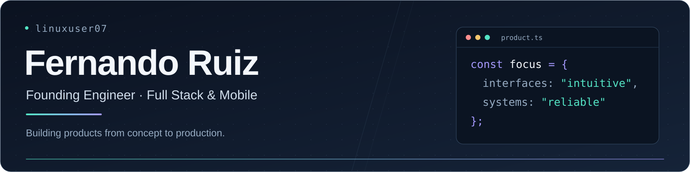

  

  <a href="https://www.linkedin.com/in/fernandoruiz07/">LinkedIn</a> &nbsp;·&nbsp;
  <a href="https://stackoverflow.com/users/6249185/linuxuser07/">Stack Overflow</a> &nbsp;·&nbsp;
  <a href="https://www.rfxsolutions.com">RFX Solutions</a> &nbsp;·&nbsp;
  <a href="https://www.myaddo.com">MyAddo</a>

## Hey, I'm Fernando 👋

I'm a founding engineer at **RFX Solutions**, based in Oklahoma City, with **eight years of software development experience**. I take products from an initial idea through frontend, backend, integrations, infrastructure, and production deployment.

My work spans medical applications, accounting platforms, legacy system migrations, and mobile apps. I enjoy understanding how people use a product and turning complicated workflows into software they can rely on every day. I also work on **[MyAddo](https://www.myaddo.com)**.

## What I'm building at RFX

Our platform serves approximately **4,000 distinct daily users** and supports **120,000 automated sanctions screenings per month**, in addition to user-initiated screenings.

- **Customer interfaces:** Own development of all customer-facing sanctions screens, plus internal controls for enabling integrations and rerunning checks across states.
- **Integrations and APIs:** Build NPDB connectivity, application APIs, and crawlers that retrieve sanctions information from online sources.
- **Mobile apps:** Own mobile development across WebView-based apps, React Native, Expo, and Flutter.
- **Performance:** Help improve log loading with MongoDB materialized views that precompute screening status, missing runs, and notification requirements.
- **Delivery:** Own work across frontend, backend, infrastructure, and production deployment.

## My toolbox

| Area | Technologies |
| --- | --- |
| Frontend | TypeScript, JavaScript, React, Angular, Vue, Next.js, TanStack Start, Redux, HTML, CSS |
| Mobile | React Native, Expo, Flutter, WebView |
| Backend and APIs | Node.js, C#, Go, GraphQL, Java, Python |
| Data | MongoDB, SQL, MySQL, SQLite, Redis |
| Cloud and delivery | Google Cloud, Docker, Linux, Nginx, Git |
| Testing | Jest, Cypress, Mocha |

<strong>Earlier engineering work</strong>

- **Surgical Care Affiliates:** Owned development of an Angular/C# accounting platform, verified financial calculations, and worked on permissions and legacy integrations.
- **Teleflora:** Independently owned a FoxPro-to-Angular/C#/SQL migration while adding new features.
- **Technical support and infrastructure:** Built a foundation in troubleshooting, networking, documentation, and helping people solve software problems.

## Learning and collaboration

I'm sharpening my skills in **algorithms, frontend performance, and system design**. I enjoy exchanging ideas, collaborating on useful projects, and helping other developers grow.

I speak **fluent Spanish, written and spoken**. If that helps us work together, ¡hablemos!

Have a project or an engineering problem you'd like to talk through? **[Connect with me on LinkedIn](https://www.linkedin.com/in/fernandoruiz07/).**
